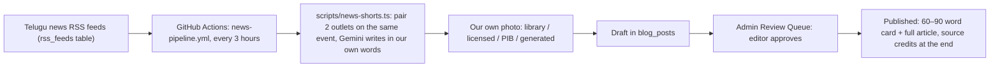

# VarthaNow Telugu AI News

Production-grade React + Supabase + Gemini AI Telugu news platform.

## Stack

- React + TypeScript + Vite
- TailwindCSS
- React Router
- Supabase PostgreSQL
- Supabase Edge Functions + Cron
- Google News RSS feeds
- Google Gemini `gemini-1.5-flash`

## Automated News Flow



- Nothing is published automatically. Every story is a draft until an editor approves it.
- Each story ends with "మూలం (Source):": the original outlets' names, small site icons and links
  (`src/lib/sources.ts`). Outlets' photos are never reused.
- Run the pipeline by hand from GitHub → Actions → "VaartaNow News Pipeline" → Run workflow, or from the
  admin RSS Feeds tab ("Run news pipeline").

## Setup

```bash
npm install
cp .env.example .env
npm run dev
```

Required env:

```bash
VITE_SITE_URL=http://localhost:3000
VITE_SUPABASE_URL=
VITE_SUPABASE_ANON_KEY=
SUPABASE_URL=
SUPABASE_SERVICE_ROLE_KEY=
GEMINI_API_KEY=
```

## Database

Run [supabase/schema.sql](supabase/schema.sql) in Supabase SQL editor. It creates the `blog_posts` table, indexes, public read policy, and admin management policy.

## Server functions

Edge functions in `supabase/functions` serve the website live (Gemini proxy, cricket scores, YouTube,
OTP, social posting). News fetching is not one of them: it runs on GitHub Actions (see above).
Database changes for aapstack.tech live in `supabase/aapstack/*.sql`, applied in order.

## SEO

- Dynamic title, description, OG, Twitter card and JSON-LD are generated client-side.
- Static `robots.txt` and `sitemap.xml` live in `public/`.
- Run `npm run sitemap` to regenerate article URLs from Supabase.

## Copyright Safety

The pipeline reads the source reports only to learn the facts. Gemini writes the story in original Telugu,
and a check rejects drafts that reuse more than 15% of a source's phrasing. Photos come from our own
library, licensed or government sources, or are generated; source outlets' photos are never used.
Sources are credited by name, small site icon and link (see the Disclaimer page).

## Tests

End-to-end tests (pytest + Playwright) run on every push: see [tests/README.md](tests/README.md).
